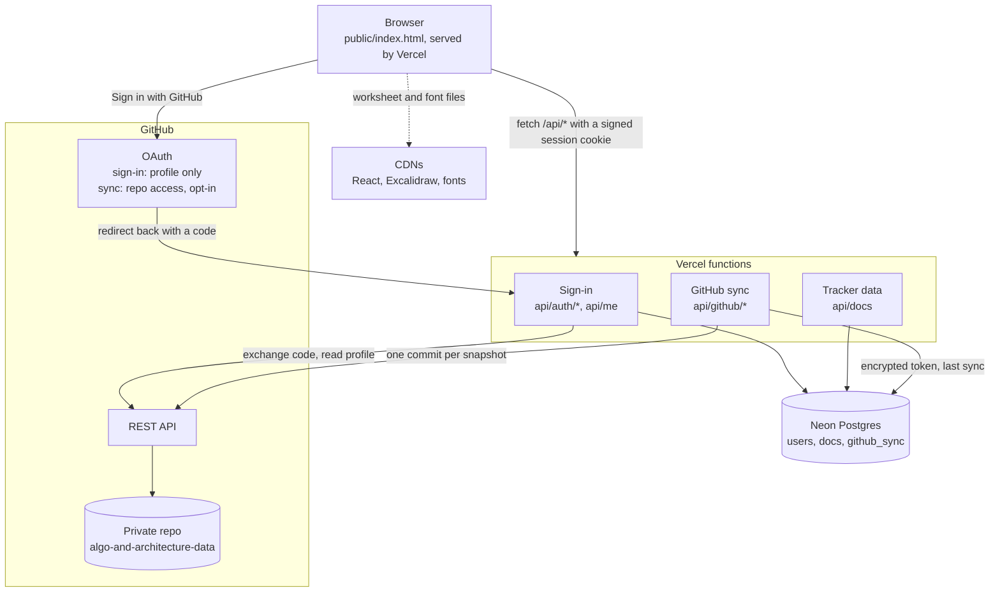

# Algo and Architecture

Spaced-repetition practice for data structures and algorithms (Blind 75, NeetCode 150, Grind 75) and a system design path. Solve a problem, rate it Red, Yellow or Green, and it comes back when it's due. Every problem has notes, a full attempt history and an Excalidraw worksheet. It comes in light and dark, following your device until you pick one.

The Roadmap tab turns a list and an interview date into a week-by-week plan, drawn as a road map: each week's problems and design topics, where you are, and whether you're on track. Problems you've already started stay in your review queue.

You don't need an account: without one, your progress is saved in your browser. Sign in with **GitHub** to keep it across devices (what you saved in the browser moves into your account), and optionally sync all your work to a private GitHub repo.

It runs on **Vercel** (the site and a few small functions) and stores signed-in users' data in **Neon** (Postgres).

## How it works



- **No account:** everything works, and records are saved in the browser's local storage. Nothing is sent to the server.
- **Sign-in:** the app sends you to GitHub, which only shares your public profile. GitHub redirects back to `api/auth/callback`, which stores your user in Neon and sets a signed session cookie. The GitHub token from sign-in is not kept. If you saved anything before signing in, the app offers to add it to your account: attempts are combined and nothing in the account is removed.
- **Your data:** the page reads and saves your attempts, notes, worksheets and settings through `api/docs`, which only touches your own rows in Neon. Other devices pick up changes within a minute.
- **GitHub sync (optional):** connecting asks GitHub for repository access in a separate step. The token is stored encrypted in Neon, and each sync writes a full snapshot to your private `algo-and-architecture-data` repo as one commit, skipping the commit when nothing changed. That's a page per problem with attempts and notes, your worksheets, your roadmap as a checklist (`ROADMAP.md`), and the raw records.
- **Worksheets:** the Excalidraw editor and fonts load from public CDNs when you open a worksheet.

## What's in here

```
public/index.html        The app (one page, no build step)
api/auth/login.js        Starts "Sign in with GitHub" (profile only, no repo access)
api/auth/callback.js     Finishes sign-in, and finishes connecting GitHub sync
api/auth/logout.js       Signs out
api/me.js                Who is signed in
api/docs.js              Your tracker records: read, save, delete
api/github/connect.js    Optional: asks GitHub for repo access to turn on sync
api/github/status.js     Sync status, and turning auto-sync on or off
api/github/sync.js       Writes a snapshot of your data to the repo as one commit
api/github/disconnect.js Turns sync off and revokes the repo access
lib/                     Shared code: database, cookies and encryption, GitHub
scripts/check.mjs        `npm run build`: checks every function loads and the page's script parses
scripts/migrate.mjs      `npm run db:migrate`: creates the tables over Neon's direct connection
scripts/dev.mjs          `npm run dev`: runs the site and functions locally
neon.ts                  Neon project config, used by the `neon` CLI
```

The app talks to Neon with `node-postgres` through Neon's pooled connection string (`DATABASE_URL`), using one small pool per function instance that Vercel Fluid compute closes when idle. `npm run db:migrate` creates the tables; each function instance also checks they exist before its first query, so a fresh database works even if you skip it.

## Set it up (about 15 minutes)

You need a GitHub account and a Vercel account (you can sign up for Vercel with GitHub). Node.js is only needed if you want to run it on your own computer.

### 1. Put this folder in a GitHub repo

Create a new repository called `algo-and-architecture` (public or private both work) and push this folder to it. The code holds no secrets: those live in Vercel's environment variables, and `.env` files are ignored by git.

### 2. Deploy it on Vercel

1. In Vercel, choose **Add New → Project** and import the repo.
2. Framework Preset: **Other**. Leave the build and output settings as they are, then **Deploy**.
3. Note your site's address, for example `https://algo-and-architecture.vercel.app`. The first deploy will load, but sign-in won't work until the steps below are done.

### 3. Connect the Neon database

The repo is set up for the Neon CLI (`neon.ts`). From the project folder:

```
npm install
npm i -g neon@latest
neon login                 # opens a browser to sign in to Neon
neon init -y --org-id <your org id> --project-id <your project id> --branch production --services postgres
neon deploy                # applies neon.ts and writes DATABASE_URL and DATABASE_URL_UNPOOLED to .env.local
npm run db:migrate         # creates the tables
```

Then copy the value of `DATABASE_URL` from `.env.local` (the pooled one, with `-pooler` in the host) into Vercel under **Settings → Environment Variables**. `.env.local` is ignored by git.

Alternatively, open your Vercel project's **Storage** tab, choose **Neon**, and connect a database there. Vercel then adds `DATABASE_URL` for you.

### 4. Create the GitHub OAuth app

1. Go to **GitHub → Settings → Developer settings → OAuth Apps → New OAuth App** (github.com/settings/developers).
2. Application name: `Algo and Architecture` (anything you like).
3. Homepage URL: your Vercel address from step 2.
4. Authorization callback URL: your Vercel address plus `/api/auth/callback`, for example `https://algo-and-architecture.vercel.app/api/auth/callback`.
5. Register the app, then click **Generate a new client secret** and copy it.

### 5. Add the remaining environment variables

In Vercel, open **Settings → Environment Variables** and add:

| Name | Value |
|---|---|
| `GITHUB_CLIENT_ID` | The Client ID from the OAuth app |
| `GITHUB_CLIENT_SECRET` | The client secret you generated |
| `SESSION_SECRET` | A random string of at least 32 characters. On a Mac or Linux terminal: `openssl rand -base64 48` |
| `PUBLIC_URL` | Optional. Only if you add a custom domain, e.g. `https://algo.example.com` (also add that domain's callback URL to the OAuth app) |

Then go to **Deployments**, open the latest one and choose **Redeploy** so the new variables take effect.

### 6. Sign in and bring your data over

1. Open your site and click **Sign in with GitHub**.
2. Go to **Settings → Backup → Restore from file** and choose `blind75-tracker-backup-2026-11-20.json` (sent alongside this project). Your attempts, notes, paused items and settings come across.

### 7. Optional: sync to a GitHub repo

In **Settings → Sync to GitHub**, click **Connect GitHub**. GitHub asks you to allow repository access (this is separate from sign-in, which never asks for it). The app then creates a private repo called `algo-and-architecture-data` (separate from this public code repo) and writes:

- `notes/coding/<problem>.md` and `notes/design/<topic>.md`: a readable page per problem with its attempts table and your notes
- `worksheets/.../*.excalidraw`: your drawings, which open at excalidraw.com
- `data/*.json`: the raw records
- `README.md`: a summary table
- `ROADMAP.md`: your Roadmap tab's plan as a weekly checklist, if you've made one

Each sync is a single commit, and nothing is committed when nothing changed. With auto-sync on, it syncs 30 seconds after you stop making changes. **Turn off sync** stops it and revokes the repo access; the repo itself stays yours.

## Good to know

- **Free tiers.** A personal tracker sits well inside Neon's free plan and Vercel's free Hobby plan (which is for personal, non-commercial use).
- **Privacy.** Each person who signs in gets their own data. Sessions are signed cookies; the sync token is stored encrypted with a key derived from `SESSION_SECRET`.
- **Changing `SESSION_SECRET`** signs everyone out and makes stored sync tokens unreadable, so GitHub sync would need to be connected again.
- **Other devices.** The app checks for changes every minute and whenever you come back to the tab.
- **Preview deployments.** GitHub sign-in only works on the URLs listed as callback URLs in the OAuth app. GitHub OAuth apps accept several callback URLs, so you can add a preview URL if you want to test there.

## Run it locally (optional)

Needs Node.js 22 or newer.

```
npm install
neon env pull              # or `neon deploy`; writes DATABASE_URL to .env.local
npm run db:migrate
npm run dev                # serves on http://localhost:3000
```

Add the other variables from `.env.example` to `.env.local`, add `http://localhost:3000/api/auth/callback` as an extra callback URL in the OAuth app, and set `PUBLIC_URL=http://localhost:3000`. `npm run build` runs the same checks Vercel runs on deploy.

## Contributing

Bug reports, ideas and pull requests are welcome. See [CONTRIBUTING.md](CONTRIBUTING.md) to run it locally in a minute (no setup needed for most changes), and [open an issue](https://github.com/emmanuel-adu/algo-and-architecture/issues/new) to report a problem.

## License

[MIT](LICENSE). Contributions are accepted under the same license.
